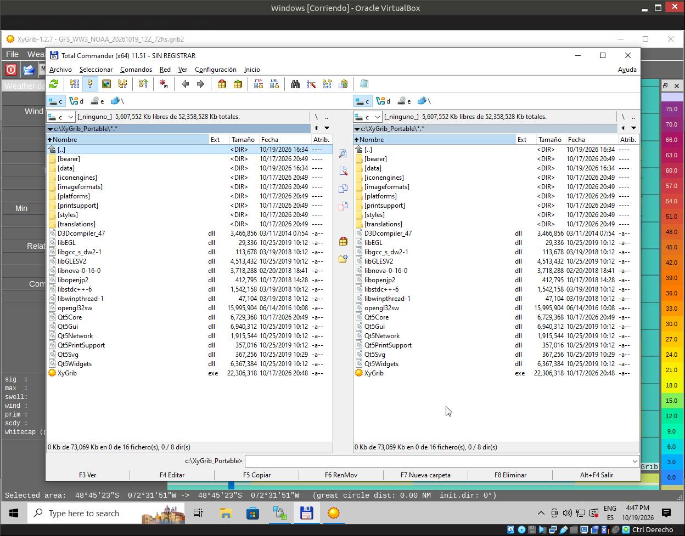
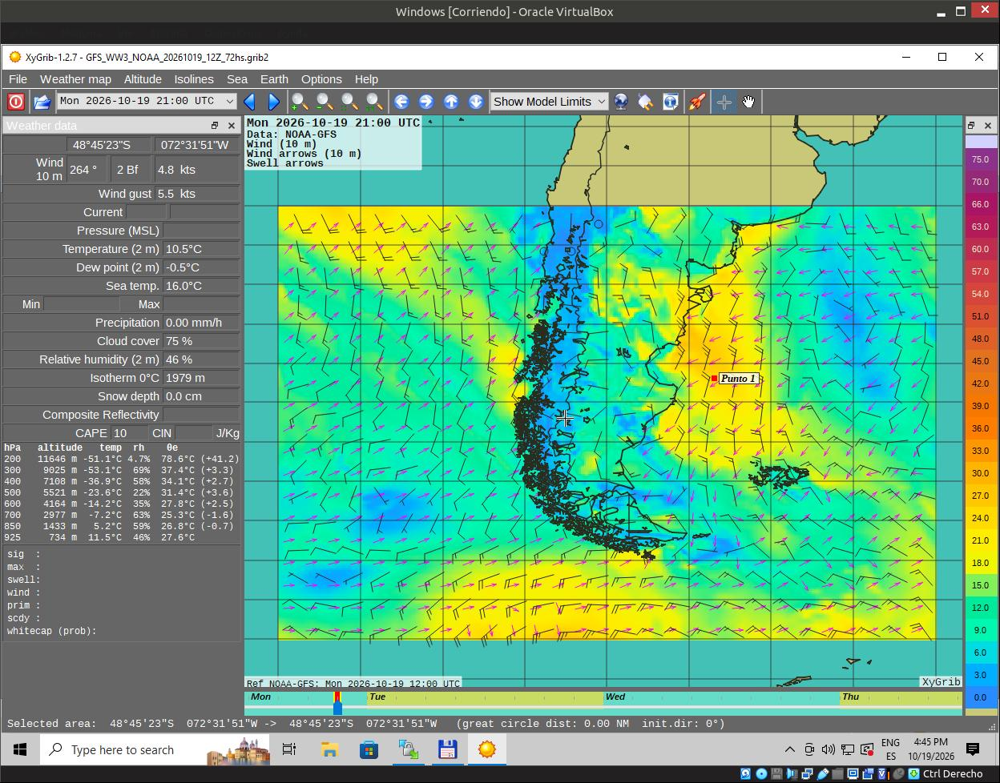
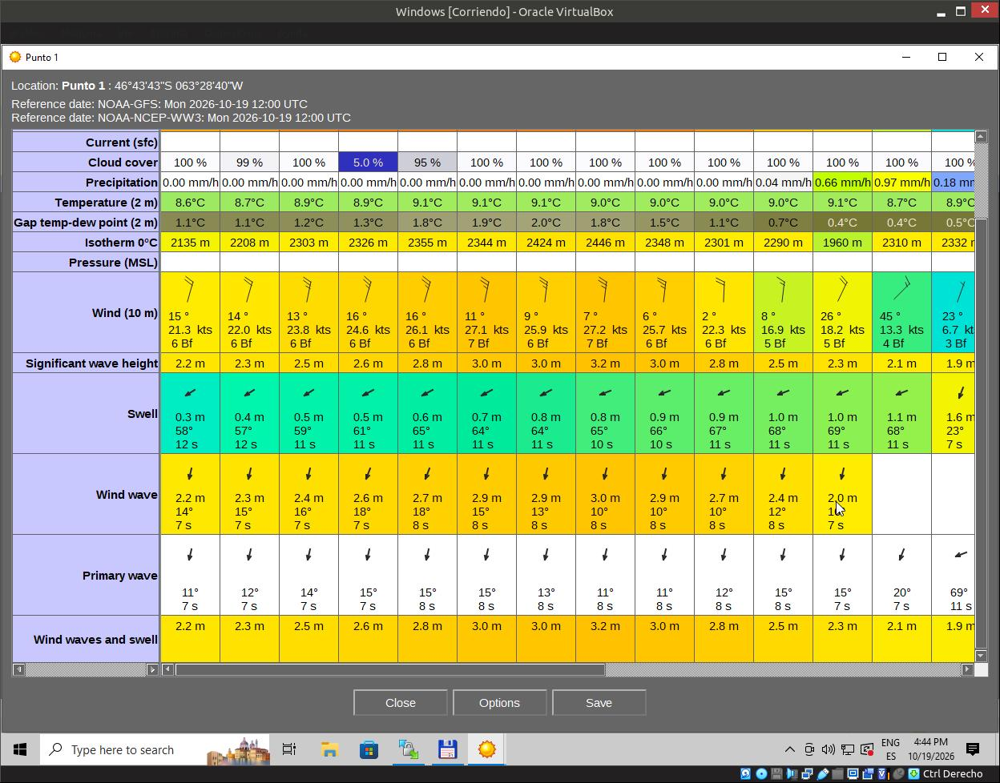

# Building XyGrib for Windows (MinGW + Qt 5.13.2)

This document describes how to build XyGrib on Windows using the open-source MinGW toolchain. It combines the original project setup with real-world fixes for modern environments, including the workaround for the 100% linker error and the missing toolbar icons.

**Note:** This build process was verified with **CMake 4.3.5**, **Qt 5.13.2 (MinGW 7.3.0 32-bit)**, and **vcpkg**.

---

## 1. Prerequisites

You need the following installed before starting:

- **Qt 5.13.2** with the **MinGW 7.3.0 32-bit** kit.
  Get the Qt online installer from [qt.io/download](https://qt.io/download). When choosing components, select exactly `Qt 5.13.2` → `MinGW 7.3.0 32-bit`. This specific version/kit combo matters.
- **CMake** (version 3.14 or newer; tested with 4.3.5). Tick "add to PATH" during the install.
- **Git for Windows**.
- **vcpkg** (for installing `libaec` and `proj`).

---

## 2. Setting up the Dependencies

XyGrib depends on several third-party C/C++ libraries. Historically, the project provided a pre-compiled `thirdpartylib.zip` (from 2018). Since some of those binaries are incompatible with the modern XyGrib codebase, the reliable approach is to combine the 2018 bundle for the core libraries with `vcpkg` for the outdated ones.

### 2.1. Install vcpkg dependencies
Open a terminal (PowerShell or CMD) and run:

```cmd
git clone https://github.com/microsoft/vcpkg
cd vcpkg
.\bootstrap-vcpkg.bat
.\vcpkg install libaec:x86-mingw-static proj:x86-mingw-static
```

### 2.2. Prepare the `C:\opt` directory

The remaining libraries (`bzip2`, `libnova`, `openjpeg`, `png`, `zlib`) are linked directly from a custom path. In the verified build, these were taken from the **original pre-compiled `thirdpartylib.zip` (from 2018)** provided by the OpenGribs project. Despite being old, these binaries still link correctly with Qt 5.13.2 / MinGW 7.3.0.

Extract the zip and place the files in `C:\opt\` with this structure:

```text
C:\opt\
├── include\   (headers for bzlib.h, libnova, openjpeg.h, png.h, zlib.h)
└── lib\       (libbz2.a, libnova.a, libopenjp2.dll.a, libpng.a, libz.a)
```

**Important notes:**
- **Do not use the 2018 PROJ library.** The bundle includes an older PROJ version that relies on `proj_api.h`. The current XyGrib codebase requires the modern PROJ API (`proj.h`), so you must use the one installed via vcpkg (step 2.1) instead.
- **Dynamic OpenJPEG:** The bundle provides `libopenjp2.dll.a`, which is an import library for *dynamic* linking. You will also need `libopenjp2.dll` itself in your portable runtime folder (see step 7.3).

---

## 3. Clone the patched branch

Open Git Bash:

```bash
git clone -b fix-swell-241 https://github.com/DrCalambre/XyGrib C:\project\xygrib
```

*(If the fix has been merged into `frfa/XyGrib` main by the time you read this, you can clone that instead — but double-check it's a clean build first).*

**Note:** the `fix-swell-241` branch actually carries two commits — the swell patch itself, and an earlier build fix that adds a missing `aecunpack.c` file plus a CMakeLists update for g2clib. Both are needed to compile cleanly from a fresh clone.

---

## 4. Set environment variables

In a plain `cmd` or `PowerShell` window (before building):

```cmd
set EXTERNLIBS=C:\opt
set PATH=C:\Qt\Tools\mingw730_32\bin;C:\Qt\5.13.2\mingw73_32\bin;%PATH%
set CC=gcc
set CXX=g++
```

**One gotcha:** if `sh.exe` (from Git Bash) is in your PATH in that terminal, CMake will refuse to generate MinGW Makefiles. Use a plain cmd/PowerShell window without Git Bash's `sh.exe` on the PATH.

---

## 5. Configuring with CMake

Open the **Qt 5.13.2 (MinGW 7.3.0 32-bit)** command prompt. Navigate to your source directory and create a `build` folder:

```cmd
cd C:\project\xygrib
mkdir build
cd build
```

Run CMake, passing the paths to both `vcpkg` and `C:\opt`:

```cmd
cmake -G "MinGW Makefiles" ^
  -DCMAKE_BUILD_TYPE=Release ^
  -DCMAKE_PREFIX_PATH="C:/project/vcpkg/installed/x86-mingw-static;C:/opt" ^
  -DCMAKE_TOOLCHAIN_FILE="C:/project/vcpkg/scripts/buildsystems/vcpkg.cmake" ^
  ..
```

**Note:** if you're re-running `cmake` in an existing `build` folder (for example, after a failed first attempt), delete `build\CMakeCache.txt` first. Otherwise CMake may keep a stale, empty `CMAKE_BUILD_TYPE` from a previous run even though you're passing `-DCMAKE_BUILD_TYPE=Release` again — which also causes it to pick up `proj`/`libaec` from vcpkg's `debug\lib\` instead of `lib\`, producing a slower, unoptimized binary.

---

## 6. Compiling (The 99% Linker Error)

Run the build:

```cmd
mingw32-make -j4
```

### ⚠️ Known Issue 1: The 99% Linker Error
The compilation of the `.cpp` files will succeed (100%), but the final link step (`c++.exe ... -o XyGrib.exe`) **may fail** with errors like `undefined reference to ...`.

**Why does this happen?**
This is caused by the linker (`ld.exe`) failing to find the correct order or exact paths of the static libraries (`libaec.a`, `libproj.a`, `libbz2.a`, etc.). MinGW's linker is strictly order-dependent (a library must appear *after* the object files that depend on it).

### ✅ The Workaround: Manual Linking
If the automated link fails, open the `link.txt` file located at:
`C:\project\xygrib\build\src\CMakeFiles\XyGrib.dir\link.txt`

Inside, you will find the exact command the linker was trying to run. Copy that entire command, paste it into your terminal, and adjust it manually:
1. Ensure the `.a` library paths match exactly what is in `C:\opt\lib` and `C:\project\vcpkg\installed\x86-mingw-static\lib` (or `debug\lib` if you kept the unoptimized build from a stale cache — see the note in step 5).
2. Reorder the `-l` flags so that libraries that depend on others come *first*.
3. Re-run the command. If successful, it will output `XyGrib.exe`.

*(Once `XyGrib.exe` exists, you can safely ignore the `make` error in the future; the executable is already built.)*

### ⚠️ Known Issue 2: Undefined references to `sqlite3` (when using modern PROJ from vcpkg)
If you are using the modern PROJ installed via `vcpkg` (step 2.1), the link step might fail with hundreds of lines like `undefined reference to 'sqlite3_open_v2'` or `undefined reference to 'sqlite3_exec'`.

**Why does this happen?**
Modern PROJ uses SQLite internally to store its database of coordinate transformations. However, CMake sometimes fails to pass the SQLite library to the linker when it resolves PROJ dynamically from `vcpkg`.

**The Solution:**
When you do the **Manual Linking** (described above), append the SQLite library path explicitly at the very end of your manual `g++.exe` command:

```cmd
-LC:/project/vcpkg/installed/x86-mingw-static/lib -lsqlite3
```

Your final command should look something like this:
```cmd
"C:/Qt/Qt5.13.2/Tools/mingw730_32/bin/g++.exe" -Wl,-subsystem,windows -mthreads -o XyGrib.exe @CMakeFiles\XyGrib.dir\objects1.rsp @CMakeFiles\XyGrib.dir\linkLibs.rsp -LC:/project/vcpkg/installed/x86-mingw-static/lib -lsqlite3
```
*(Run this from the `C:\project\xygrib\build\src` directory where the `.rsp` files live).*

If you see the command finish without errors, you will have a valid `XyGrib.exe` (around 113 MB) in that folder.

---

## 7. Creating the Portable Folder (Runtime)

To run `XyGrib.exe`, you need the runtime `.dll` files and the `data` folder. Do **not** copy the `.dll` files from the compilation folders (like `/opt` or `vcpkg`), as those are linker libraries, not runtime libraries.

### 7.1. Create the portable folder and deploy Qt DLLs
Create a dedicated folder for your portable build (e.g., `C:\XyGrib_Portable`), copy `XyGrib.exe` from `C:\project\xygrib\build\src\` into it, and open a Qt command prompt in that new folder:

```cmd
mkdir C:\XyGrib_Portable
copy C:\project\xygrib\build\src\XyGrib.exe C:\XyGrib_Portable\
cd C:\XyGrib_Portable
windeployqt XyGrib.exe
```

This will automatically copy the correct Qt `.dll` files (and the necessary plugin folders like `platforms`, `styles`, `imageformats`) directly into `C:\XyGrib_Portable`.

### 7.2. Copy the Data Folder (Icons and Maps)
If you launch the application and the toolbar icons are missing (empty buttons), it means XyGrib cannot find its resources. 

Copy the entire `data` folder from the root of your source repository (`C:\project\xygrib\data`) into `C:\XyGrib_Portable\`.

Your final portable folder should look like this:



```text
C:\XyGrib_Portable\
├── data\               <-- (Icons, maps, translations)
├── platforms\          <-- (Qt platform plugins)
├── imageformats\       <-- (Qt image plugins)
├── Qt5Core.dll
├── Qt5Gui.dll
├── ...
└── XyGrib.exe
```

---

### 7.3. Copy the MinGW Runtime DLLs and OpenJPEG
`XyGrib.exe` is dynamically linked against the MinGW runtime (confirmed by inspecting `build\src\CMakeFiles\XyGrib.dir\link.txt` — it has no `-static-libgcc -static-libstdc++ -static` flags). Additionally, OpenJPEG is linked dynamically. 

`windeployqt` only handles Qt's own DLLs, so these files still need to be copied manually into `C:\XyGrib_Portable\`:

**From `C:\Qt\Qt5.13.2\Tools\mingw730_32\bin\`:**
- `libgcc_s_dw2-1.dll` (or `libgcc_s_seh-1.dll`, depending on your toolchain build — check which one exists in that folder)
- `libstdc++-6.dll`
- `libwinpthread-1.dll`

**From `C:\opt\bin\` (or wherever your 2018 `thirdpartylib.zip` extracted the binaries):**
- `libopenjp2.dll`

Without these, `XyGrib.exe` will fail to start on any machine that doesn't have Qt/MinGW installed, even though the portable folder looks complete otherwise.

---

## 8. Verification

Once the portable folder is assembled, launch `XyGrib.exe`, load a GRIB2 file (e.g., generated by the `xygrib-noaa.sh` downloader), and verify:
1. The toolbar icons are visible.
2. The "Swell" layer is accessible and displays data (requires the `fix-swell-241` branch).

**Map View:**


**Meteogram/Data Table:**


---

If this works for you, it might be worth building a release `.exe` and attaching it to the fork's GitHub releases page, so other non-Linux users on this thread don't have to repeat the whole toolchain setup.

Fair winds! ⛵
